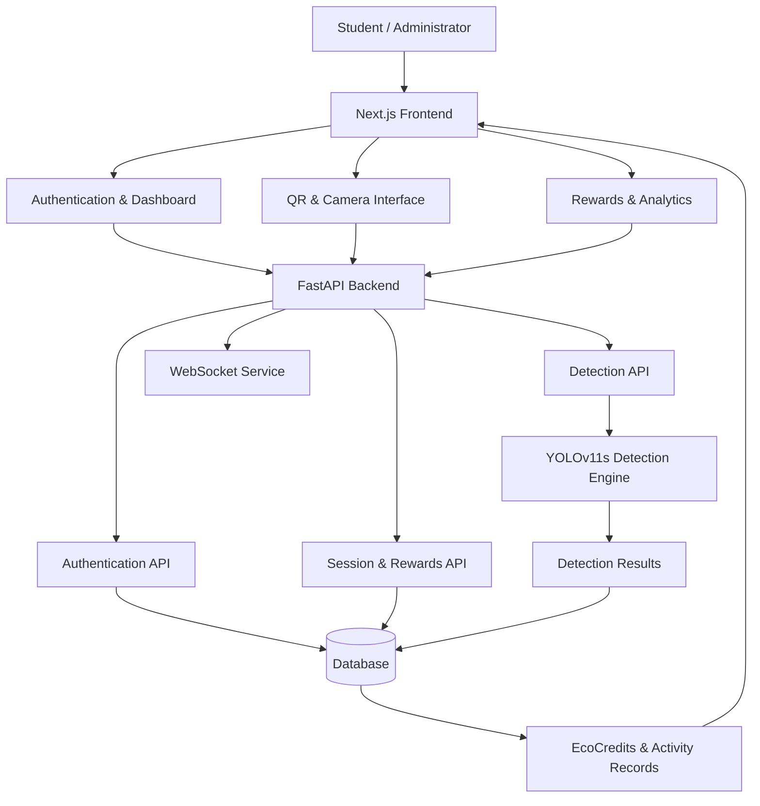
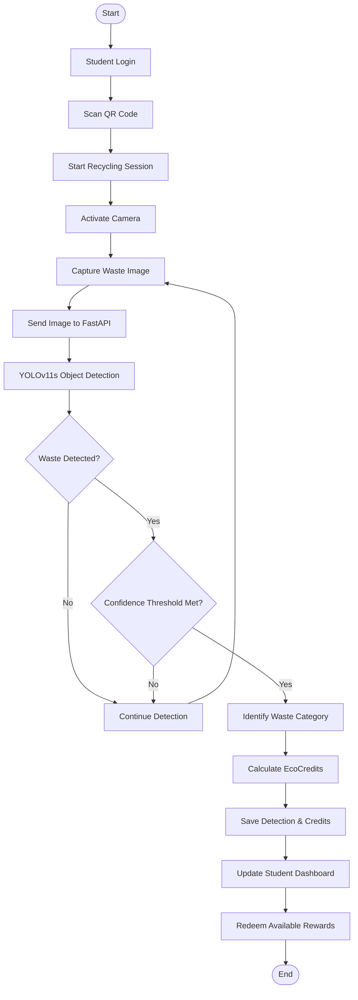
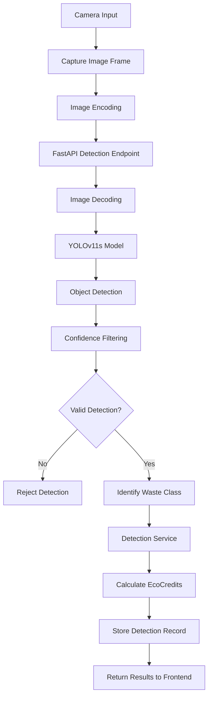
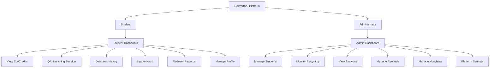

# 🌿 ReWorthAI – AI-Powered Smart Recycling & Reward Platform

### Turning Waste into Rewards with Artificial Intelligence

ReWorthAI is an AI-powered smart recycling platform designed to encourage sustainable waste management through intelligent waste detection and digital rewards.

It integrates YOLOv11s-based object detection, QR-based recycling sessions, and an EcoCredits reward system to motivate students to dispose of waste responsibly.

The platform identifies recyclable materials through camera-based detection, tracks recycling activities, and rewards users with EcoCredits that can be redeemed for rewards.

---

## 📌 Table of Contents

- Overview
- Key Features
- System Architecture
- Working Flow
- Technology Stack
- Waste Detection Process
- User Roles
- Project Structure
- Installation & Setup
- Future Enhancements

---

## 🚀 Key Features

### 1. AI-Powered Waste Detection
- YOLOv11s-based object detection.
- Real-time camera frame processing.
- Waste classification using a custom-trained model.
- Confidence-based detection filtering.

### 2. QR-Based Recycling Sessions
- QR-based recycling session access.
- Student-linked recycling sessions.
- Configurable session duration.
- Session status management.

### 3. EcoCredits Reward System
- Automatic credit calculation for detected waste.
- Student recycling activity tracking.
- EcoCredits balance management.
- Reward redemption and voucher management.

### 4. Student Dashboard
- Student registration and login.
- Personal EcoCredits balance.
- Recycling activity history.
- Leaderboard rankings.
- Reward redemption.
- Profile management.

### 5. Admin Dashboard
- Separate administrator authentication.
- Student management.
- Recycling activity monitoring.
- Waste collection analytics.
- Reward and voucher management.
- Platform statistics.

### 6. Real-Time Communication
- WebSocket integration.
- Live camera frame processing.
- Backend detection services.
- Real-time application communication.

---

# 🏗️ System Architecture

The following diagram illustrates how the frontend, backend, AI detection engine and database interact.



### Architecture Explanation

1. Users interact with the Next.js frontend.
2. The frontend communicates with the FastAPI backend.
3. The backend handles authentication, sessions, detection and rewards.
4. The YOLOv11s model processes submitted camera frames.
5. Detection results are processed and recorded in the database.
6. Valid detection results contribute to the EcoCredits system.
7. Students can view their credits, activities and rewards.

---

# 🔄 Working Flow of ReWorthAI

This diagram explains the complete recycling process from student authentication to reward redemption.



### Working Process

| Step | Process | Description |
|---|---|---|
| 1 | Authentication | Student logs into the platform. |
| 2 | QR Scanning | Student accesses a recycling session. |
| 3 | Session | Recycling session is activated. |
| 4 | Camera | Camera captures waste images. |
| 5 | AI Detection | YOLOv11s identifies waste objects. |
| 6 | Validation | Detection confidence is checked. |
| 7 | Credit Calculation | EcoCredits are calculated. |
| 8 | Database | Detection and credit records are stored. |
| 9 | Rewards | Students redeem available rewards. |

---

# 🤖 AI Waste Detection Architecture

ReWorthAI uses a custom-trained YOLOv11s model to identify waste objects from camera frames.



### Detection Process

- Camera captures an image or video frame.
- The frontend sends image data to the backend.
- FastAPI processes the incoming image.
- YOLOv11s identifies waste objects.
- Confidence filtering validates the detection.
- The detection service calculates applicable EcoCredits.
- Detection records are stored in the database.

---

# 👥 User Role Architecture

ReWorthAI provides separate interfaces for students and administrators.



---

# 🛠️ Technology Stack

| Component | Technologies |
|---|---|
| Frontend | Next.js 16, React 19 |
| Programming Language | TypeScript, Python |
| Styling | Tailwind CSS |
| Backend | FastAPI |
| AI / Computer Vision | YOLOv11s, Ultralytics |
| Image Processing | Pillow |
| Database | SQLite / PostgreSQL support |
| ORM | SQLAlchemy |
| Authentication | JWT |
| API Communication | REST API |
| Real-Time Communication | WebSockets |
| Data Visualization | Recharts |
| State Management | Zustand |

---

# 📂 Project Structure

```text
ReWorthAI/
│
├── app/
│   ├── (auth)/
│   │   ├── login/
│   │   ├── register/
│   │   ├── forgot-password/
│   │   └── reset-password/
│   │
│   ├── (student)/
│   │   ├── dashboard/
│   │   ├── activity/
│   │   ├── leaderboard/
│   │   ├── profile/
│   │   ├── qr/
│   │   └── rewards/
│   │
│   ├── admin/
│   │   ├── dashboard/
│   │   ├── analytics/
│   │   ├── history/
│   │   ├── users/
│   │   ├── rewards/
│   │   └── vouchers/
│   │
│   └── page.tsx
│
├── backend/
│   ├── app/
│   │   ├── api/
│   │   ├── core/
│   │   ├── database/
│   │   ├── models/
│   │   ├── repositories/
│   │   ├── schemas/
│   │   ├── services/
│   │   └── utils/
│   │
│   ├── yolo/
│   │   ├── best.pt
│   │   └── yolo_detector.py
│   │
│   └── requirements.txt
│
├── api/
├── components/
├── lib/
├── providers/
├── services/
├── store/
├── public/
│
├── package.json
├── next.config.ts
├── tsconfig.json
└── README.md
```

---

# ⚙️ Installation & Setup

### Prerequisites

- Node.js 20.9 or later
- Python 3.10 or later
- Git
- npm

### 1. Clone Repository

```bash
git clone https://github.com/Yuvaraj471/-ReWorthAI.git
```

```bash
cd -ReWorthAI
```

### 2. Backend Setup

```bash
cd backend
```

Create a virtual environment:

```bash
python -m venv venv
```

Activate it on Windows:

```bash
venv\Scripts\activate
```

Install dependencies:

```bash
pip install -r requirements.txt
```

### 3. Environment Configuration

Create a `.env` file inside the backend folder.

```env
SECRET_KEY=your_secure_secret_key
DATABASE_URL=sqlite:///./reworth.db
FRONTEND_URL=http://localhost:3000

YOLO_CONFIDENCE_THRESHOLD=75.0
SESSION_DURATION_SECONDS=60

ACCESS_TOKEN_EXPIRE_MINUTES=30
REFRESH_TOKEN_EXPIRE_DAYS=7
```

Generate a secure secret key before running the application.

### 4. Start Backend

```bash
uvicorn app.main:app --reload --port 8000
```

Backend:

http://localhost:8000

API Documentation:

http://localhost:8000/docs

### 5. Frontend Setup

Open another terminal in the project root.

Install dependencies:

```bash
npm install
```

Start the frontend:

```bash
npm run dev
```

Frontend:

http://localhost:3000

---

# 🎯 Project Objectives

- Promote responsible waste disposal.
- Encourage recycling through digital incentives.
- Automate waste identification using Artificial Intelligence.
- Improve environmental awareness among students.
- Track recycling activities and contributions.
- Develop a technology-driven sustainable recycling ecosystem.

---

# 🔮 Future Enhancements

- IoT-enabled smart recycling bin integration.
- Hardware-based automatic waste segregation.
- Advanced waste analytics and reporting.
- Cloud deployment and scalability.
- Expanded waste classification capabilities.
- Integration with additional sustainability platforms.

---

# 👨‍💻 Developer

**Yuvaraj D**

AI & Data Science | Artificial Intelligence | Computer Vision | Automation

GitHub: [Yuvaraj471](https://github.com/Yuvaraj471)

---

# 📄 License

This project is developed for educational and innovation purposes.